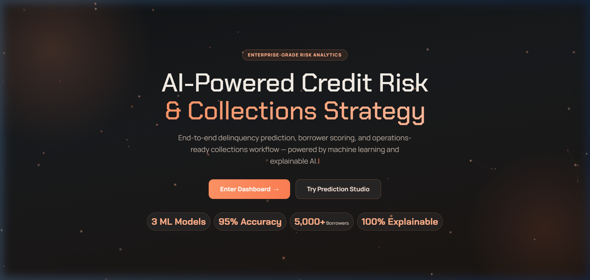
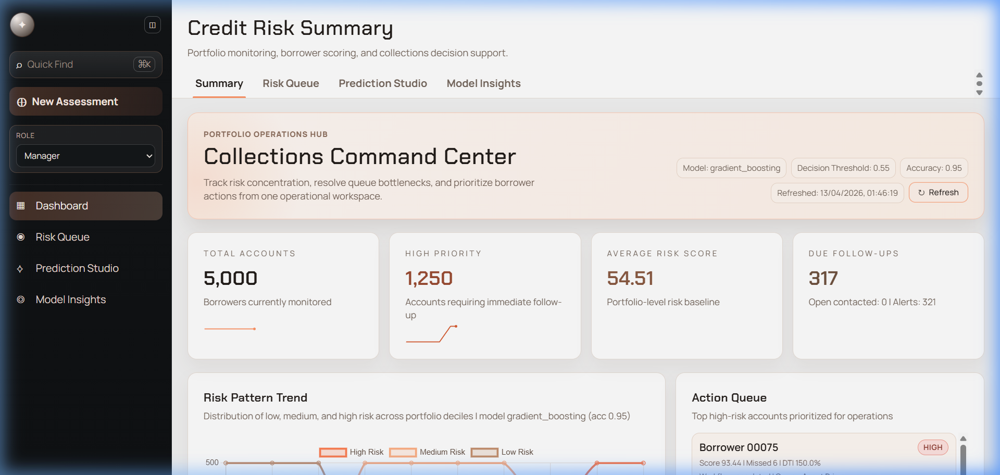
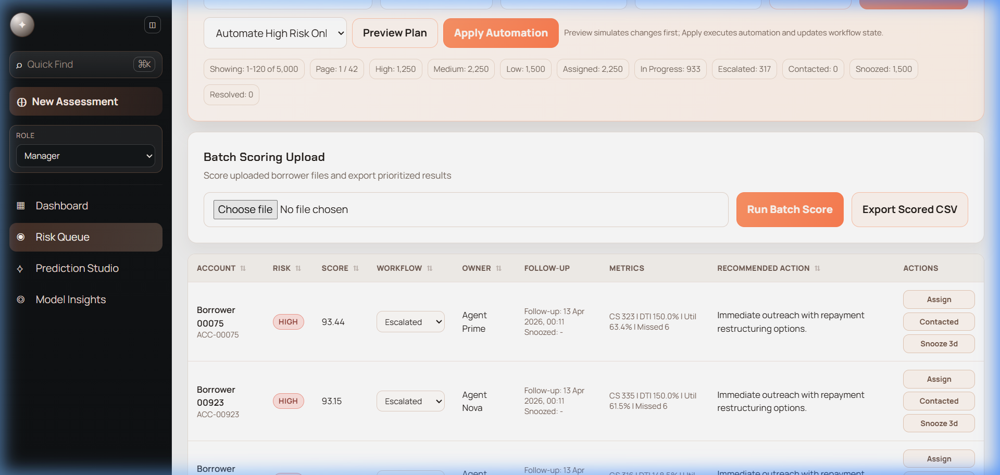
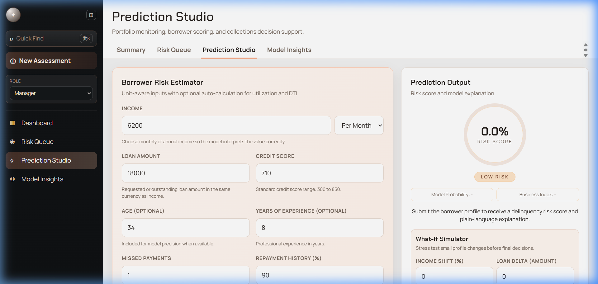

# AI-Powered Credit Risk & Collections Strategy

<div align="center">



**End-to-end delinquency prediction, borrower scoring, and operations-ready collections workflow — powered by machine learning and explainable AI.**

[](https://python.org)
[](https://fastapi.tiangolo.com)
[](https://reactjs.org)
[](https://scikit-learn.org)
[](https://vitejs.dev)

</div>

---

## 📸 Screenshots

<details>
<summary><strong>Dashboard — Collections Command Center</strong></summary>



</details>

<details>
<summary><strong>Risk Queue — Sortable, Filterable Operations Table</strong></summary>



</details>

<details>
<summary><strong>Prediction Studio — Borrower Risk Estimator + What-If Simulator</strong></summary>



</details>

---

## Table of Contents

- [What This Project Does](#what-this-project-does)
- [Key Features](#key-features)
- [System Architecture](#system-architecture)
- [Technology Stack](#technology-stack)
- [Data Pipeline and Schema Logic](#data-pipeline-and-schema-logic)
- [Model Training and Scoring Logic](#model-training-and-scoring-logic)
- [Portfolio Workflow and Automation Engine](#portfolio-workflow-and-automation-engine)
- [API Reference](#api-reference)
- [Frontend Experience and UX](#frontend-experience-and-ux)
- [Security and RBAC](#security-and-rbac)
- [Run Locally](#run-locally)
- [Project Structure](#project-structure)
- [Troubleshooting](#troubleshooting)

---

## What This Project Does

A credit risk analytics and collections decision-support prototype that:

- Ingests financial tabular data from CSV/XLSX with schema normalization
- Performs EDA summaries and interaction diagnostics
- Trains **3 ML classifiers** and auto-selects the best candidate model
- Calibrates raw model probability with business-risk logic and stress-aware overrides
- Exposes a **FastAPI backend** for scoring, portfolio operations, monitoring, and governance
- Provides a **React dashboard** for queue handling, scenario simulation, and model insights

### Core Outcomes

| Capability | Description |
|---|---|
| 🎯 **Risk Scoring** | Probability + category (low/medium/high) |
| 🔍 **Explainability** | Driver impacts + human-readable explanations |
| 📋 **Collections Strategy** | Automated recommendations (priority, next steps) |
| ⚙️ **Workflow Operations** | Assign, status updates, snooze, follow-up scheduling, notes |
| 🤖 **Auto-Orchestration** | Rule-based automation with dry-run preview |
| 📊 **Model Monitoring** | Drift detection, override rate tracking, performance history |

---

## Key Features

### Landing Page
- 🎬 **Animated particle background** with peach-tone theme
- ⌨️ **Typing effect** on hero subtitle
- 📈 **Animated count-up statistics** (3 ML Models, 3 evaluation splits, 8 workflow states)
- 🎨 **Scroll-reveal animations** on feature cards

### Dashboard
- 📊 **KPI cards with sparkline mini-charts** — clickable, linking to filtered views
- 🔄 **Refresh button** with spin animation and toast feedback
- 📉 **Risk Pattern Trend chart** with decile distribution
- 🚨 **Alert Center** with severity-based badges
- 👤 **Owner workload** distribution bars

### Risk Queue
- 🔀 **Sortable table columns** — click any header to sort asc/desc
- 🔍 **Search, filter, and pagination** with URL persistence
- ⚡ **Inline workflow actions** — assign, contact, snooze in one click
- 📜 **Account timeline** with full event history and case notes
- 📤 **CSV export** and **batch scoring upload**
- 🤖 **Auto-orchestration** with preview/apply modes

### Prediction Studio
- 🧮 **Borrower Risk Estimator** with unit-aware inputs
- 🔮 **What-If Simulator** — stress-test income shifts, loan changes, missed payments
- 💾 **Save/load borrower profiles** (localStorage)
- 📊 **Risk gauge** with conic gradient visualization
- 🏷️ **Top risk drivers** with directional impact bars

### Model Insights
- 🏆 **Champion-Challenger governance** with one-click promotion
- 📉 **Drift Watch** — feature-level shift against training baseline
- 🔗 **Feature Correlation Map** (Chart.js)
- 📈 **Monitoring History** snapshots

### Global UX
- 🔔 **Toast notification system** — success/error/info with auto-dismiss
- 📊 **Top progress bar** — thin animated bar during API calls
- ✨ **Page transitions** — fade+slide between tabs
- ⌨️ **Keyboard shortcuts** — `Ctrl+K` (Quick Find), `Ctrl+Shift+N` (New Assessment)
- 💀 **Skeleton loaders** — structured loading states on all pages
- 📱 **Mobile responsive** — hamburger menu + slide-out sidebar
- 🛡️ **Error Boundary** — themed crash recovery fallback
- 🚫 **404 Page** — themed "Page Not Found" with navigation
- 🔗 **Open Graph meta tags** — rich LinkedIn/Twitter social previews
- ✦ **Custom SVG favicon** matching brand identity

---

## System Architecture

```
┌─────────────┐     Bearer token     ┌──────────────────┐
│   React 18  │ ──────────────────►  │   FastAPI Server  │
│   (Vite)    │ ◄──────────────────  │   (Python 3.12+)  │
└─────────────┘    JSON responses    └──────────────────┘
                                            │
                                     ┌──────┴──────┐
                                     │  scikit-learn │
                                     │  Model Engine │
                                     └─────────────┘
```

**Startup Flow:**
1. Resolve dataset path (or fallback to synthetic generation)
2. Normalize and sanitize schema
3. Split labeled data, then learn preprocessing from training rows only
4. Reuse a compatible cached artifact, or train/calibrate candidates and compute held-out metrics
5. Build scored portfolio records
6. Rehydrate persisted workflow state

---

## Technology Stack

### Backend
| Technology | Purpose |
|---|---|
| Python 3.12+ | Runtime |
| FastAPI | REST API framework |
| Pydantic v2 | Request/response validation |
| scikit-learn | Model training (LR, RF, GBM) |
| Pandas / NumPy | Data processing |
| joblib | Model serialization |
| openpyxl | Excel file support |

### Frontend
| Technology | Purpose |
|---|---|
| React 18 | UI framework |
| React Router v6 | Client-side routing |
| Vite | Build tool + HMR |
| Tailwind CSS | Utility-first styling |
| Chart.js | Data visualizations |
| Custom CSS | Glassmorphism, animations, toasts |

---

## Data Pipeline and Schema Logic

**Canonical feature schema:**

| Field | Type | Range | Description |
|---|---|---|---|
| income | float | 0–1,000,000 | Annualized income |
| credit_score | float/int | 300–850 | Credit score signal |
| credit_utilization | float | 0.0–1.0 | Credit utilization ratio |
| debt_to_income_ratio | float | 0.0–1.5 | Debt-to-income ratio |
| missed_payments | float/int | 0–60 | Missed payment count |
| repayment_history | float | 0.0–1.0 | On-time repayment ratio |
| delinquent (target) | int | 0 or 1 | Delinquency label |

**Optional features:** `age`, `loan_amount`, `years_experience`

**Normalization capabilities:**
- Alias-based column mapping (e.g. `Credit_Score`, `LoanAmount`)
- Approval-style target inversion for delinquency semantics
- Auto-derivation of missing fields (DTI/utilization from income + loan amount)
- Conservative proxy synthesis for missing behavioral fields

---

## Model Training and Scoring Logic

**Candidate models:** Logistic Regression · Random Forest · Gradient Boosting

**Selection and evaluation:**
- Stratified 64% training / 16% validation / 20% test split with fixed seed.
- Training-only median imputation, feature defaults, scaling, and directional diagnostics.
- Three-fold sigmoid calibration inside the training partition; each fold fits its own imputation, feature engineering, and scaler.
- Validation average precision selects the model, with F1 and ROC AUC as tie breakers.
- Thresholds maximize validation F1, then balanced accuracy; risk bands use validation scores only.
- Test metrics include precision, recall, F1, balanced accuracy, ROC AUC, average precision, and Brier score.
- Calibrated model estimates and business-adjusted scores have separate evaluations and baseline comparisons.
- Weak validation discrimination and proxy/synthetic labels are surfaced in the UI.

**Data integrity:**
- The bundled delinquency-labeled dataset takes precedence over the approval dataset. The smaller dataset has weak validation signal; the application does not claim a fixed accuracy.
- Approval inversion is explicitly labeled `approval_proxy`, never represented as observed delinquency.
- Missing outcomes are dropped, invalid/nonbinary outcomes fail, and single-class outcomes are never replaced by feature-derived labels.
- Data provenance identifies the source, target semantics, derived inputs, and removed rows.
- Stable source-based account IDs preserve workflow associations when rows are reordered. Old positional IDs (`ACC-00001`) are intentionally not attached to new accounts.
- The model cache fingerprints data, preprocessing/training source, and numerical-library versions. Changes trigger retraining; compatible caches preserve a promoted champion across restart.

**Engineered features:**
`utilization_dti_interaction` · `payment_stress_index` · `credit_pressure` · `income_buffer` · `credit_income_pressure` · `loan_to_income_ratio_raw` · `experience_credit_buffer`

**Scoring outputs:**
- `risk_probability` (legacy field for the normalized business-adjusted score), `risk_score` (0-100), `risk_category`
- `model_probability`, `business_risk_index`
- `override_applied`, `override_reason`
- `top_drivers` (local median-replacement sensitivity; signed, non-additive, not SHAP)
- `collections_strategy` (strategy + priority + next steps)
- `explanation` (plain-language risk summary)

---

## Portfolio Workflow and Automation Engine

**Manual workflow actions:**
- Assign/unassign owner
- Update status (`new` → `assigned` → `in_progress` → `contacted` → `promise_to_pay` → `snoozed` → `escalated` → `resolved`)
- Schedule follow-up dates
- Snooze until date
- Add case notes with timeline tracking

**Auto-orchestration policies** (`POST /portfolio/workflow/auto`):

| Risk Profile | Action |
|---|---|
| High + severe indicators | Escalate + 24h follow-up |
| High + standard | Move to in_progress + 48h follow-up |
| Medium risk | Assign + 5-day follow-up |
| Low + inactive | Snooze for 14 days |

Supports `dry_run` preview mode before applying changes.

---

## API Reference

| Endpoint | Method | Permission | Description |
|---|---|---|---|
| `/health` | GET | public | Health check |
| `/insights` | GET | read | Dataset + model analytics |
| `/portfolio` | GET | read | Paginated portfolio with filters |
| `/portfolio/{id}` | GET | read | Single account with timeline |
| `/portfolio/{id}/workflow` | PATCH | workflow_update | Update case workflow |
| `/portfolio/workflow/auto` | POST | workflow_update | Auto-orchestration |
| `/portfolio/batch-score` | POST | batch_score | Batch CSV/Excel scoring |
| `/predict` | POST | predict | Single borrower risk prediction |
| `/alerts` | GET | read | Operational alerts |
| `/model-monitoring` | GET | read | Drift + override metrics |
| `/model-versions` | GET | read | Model registry |
| `/model-versions/promote` | POST | model_promote | Champion-challenger promotion |

---

## Frontend Experience and UX

| Route | Page | Purpose |
|---|---|---|
| `/` | Landing Page | Animated hero with particle background and CTAs |
| `/dashboard` | Dashboard | KPI overview, trend chart, alerts, action queue |
| `/risk-queue` | Risk Queue | Sortable table, workflow actions, timeline, batch scoring |
| `/prediction` | Prediction Studio | Single-case scoring, what-if simulation, saved profiles |
| `/insights` | Model Insights | Monitoring, drift, candidate comparison, governance |

**Interactive UX features:**
- Toast notifications on every mutation (assign, score, promote)
- Top progress bar during API calls
- Smooth page transitions between tabs
- Keyboard shortcuts: `Ctrl+K` (Quick Find) · `Ctrl+Shift+N` (New Assessment)
- Skeleton loaders with card-shaped placeholders
- Mobile hamburger menu with slide-out sidebar overlay

---

## Security and RBAC

| Role | Permissions |
|---|---|
| `analyst` | read, predict |
| `agent` | read, predict, workflow_update, batch_score |
| `manager` | All agent permissions + model_promote |

Protected mode uses `Authorization: Bearer <key>`. Set `CREDIT_RISK_ROLE_KEYS` to a JSON mapping of roles to distinct random secrets of at least 16 characters. Roles are derived on the server; `X-User-Role` cannot elevate access. Enter the corresponding key in the sidebar's API token field; it is kept in session storage, never bundled into frontend code.

Without credentials, API access fails closed. For a local demo only, explicitly set `CREDIT_RISK_DEMO_MODE=1`; this enables the role selector and accepts `X-User-Role`. Configured role keys always take precedence over demo mode. Invalid authentication configuration fails closed. Use HTTPS for protected deployments.

Workflow writes use an in-process lock, atomic file replacement, and rollback on write failure. This is a **single-worker prototype**: use a transactional database/shared state before running multiple workers or replicas. Model artifacts use joblib and must only be loaded from trusted local storage.

---

## Run Locally

### Prerequisites

- Python 3.12 (the pinned numerical stack requires 3.12+)
- Node.js 20+ (CI uses Node.js 22)

### Backend (PowerShell)

```powershell
cd backend
python -m venv .venv
.\.venv\Scripts\Activate.ps1
python -m pip install -r requirements-lock.txt
Copy-Item .env.example .env
python -m uvicorn main:app --reload --host 127.0.0.1 --port 8000
```

The copied `.env` explicitly enables local demo mode. For protected use, disable demo mode and configure `CREDIT_RISK_ROLE_KEYS` as described above. Keep `.env` and tokens out of Git. On macOS/Linux, activate with `source .venv/bin/activate` and copy with `cp .env.example .env`.

`CREDIT_RISK_DATASET` optionally selects a dataset. A missing explicit path is an error. With no override, the bundled delinquency dataset is preferred; synthetic fallback is used only when no candidate data file exists. `backend/.env` is loaded automatically; existing process variables take precedence.

### Frontend

```powershell
cd frontend
npm.cmd ci
npm.cmd run dev
```

| Service | URL |
|---|---|
| Frontend | `http://127.0.0.1:5173` |
| Backend | `http://127.0.0.1:8000` |
| API Docs | `http://127.0.0.1:8000/docs` |

`VITE_API_URL` can override the backend URL. Never put an API secret in a `VITE_*` variable. Servers bind to loopback by default.

### Verification (from repository root)

```powershell
backend\.venv\Scripts\python.exe -m unittest discover -s backend/tests -v
npm.cmd --prefix frontend test
npm.cmd --prefix frontend run build
```

GitHub Actions runs backend regression checks, Python lint/format checks, frontend API tests, and the production build on pushes and pull requests. `requirements-lock.txt` captures the verified Python environment; `requirements.txt` lists direct dependency ranges.

Batch uploads accept CSV and XLSX (including workbooks renamed `.csv`), with a 5 MiB file limit and 20,000-row limit. Batch scoring reuses training defaults rather than upload medians. The query `limit` caps returned results, not processing limits. Income in uploads is annual; single predictions can specify annual or monthly income.

---

## Project Structure

```
├── assets/                         # README screenshots
├── backend/
│   ├── main.py                     # FastAPI endpoints, RBAC, workflow engine
│   ├── model.py                    # Training, calibration, explainability
│   ├── data_processing.py          # Dataset loading, schema mapping, EDA
│   ├── tests/                      # Data, model, API, auth and persistence regression tests
│   ├── requirements-lock.txt        # Verified Python dependency versions
│   └── requirements.txt
├── frontend/
│   ├── public/
│   │   ├── favicon.svg             # Custom brand favicon (✦)
│   │   └── og-image.png            # Social preview image
│   ├── src/
│   │   ├── api.js                  # API client, role header, timeout
│   │   ├── App.jsx                 # Router shell, page transitions
│   │   ├── main.jsx                # Entry point, ErrorBoundary, ToastProvider
│   │   ├── index.css               # Full design system + animations
│   │   ├── components/
│   │   │   ├── NavBar.jsx          # Sidebar, keyboard shortcuts, mobile menu
│   │   │   ├── GlassCard.jsx       # Glassmorphism card wrapper
│   │   │   ├── KpiCard.jsx         # Dashboard KPI card with sparkline support
│   │   │   ├── ToastProvider.jsx   # Global toast notification system
│   │   │   ├── TopProgressBar.jsx  # Loading progress bar
│   │   │   ├── Sparkline.jsx       # Inline SVG mini-chart
│   │   │   ├── AnimatedCounter.jsx # Count-up animation on scroll
│   │   │   ├── TypingEffect.jsx    # Character-by-character typing
│   │   │   ├── ParticleBackground.jsx # Canvas particle animation
│   │   │   ├── SkeletonLoader.jsx  # Structured loading placeholder
│   │   │   └── ErrorBoundary.jsx   # React error boundary fallback
│   │   ├── pages/
│   │   │   ├── LandingPage.jsx     # Animated landing + hero section
│   │   │   ├── Dashboard.jsx       # KPIs, trend, alerts, action queue
│   │   │   ├── RiskQueue.jsx       # Sortable table, workflow, timeline
│   │   │   ├── RiskPrediction.jsx  # Risk estimator + what-if simulator
│   │   │   ├── Insights.jsx        # Monitoring, drift, governance
│   │   │   └── NotFound.jsx        # Themed 404 page
│   │   └── charts/                 # Chart.js adapters
│   └── index.html                  # OG meta tags + Twitter cards
└── README.md
```

---

## Troubleshooting

| Issue | Solution |
|---|---|
| Queue feels slow | Confirm frontend calls `/portfolio` with `summary_mode=light` |
| Auto-orchestration shows 0 updates | Check `already_orchestrated` counter — scope may be aligned |
| Prediction fails with ratio errors | Provide `credit_utilization` + `debt_to_income_ratio`, or `loan_amount` for auto-derivation |
| Dataset load issues | Verify target file exists; an invalid explicit path fails; synthetic fallback only applies when no default file exists |
| PowerShell blocks npm | Use `npm.cmd run dev` instead |

---

## Notes and Extensibility

- Modular architecture designed for workshop and demo scenarios
- Can be extended with: database persistence, scheduled retraining, model registry backing store, async task queues
- Workflow state file (`backend/portfolio_workflow_state.json`) is operational state, not source code
- Social preview image and meta tags are ready for LinkedIn/Twitter sharing

---

<div align="center">

**Built with ❤️ using React, FastAPI, and scikit-learn**

</div>
